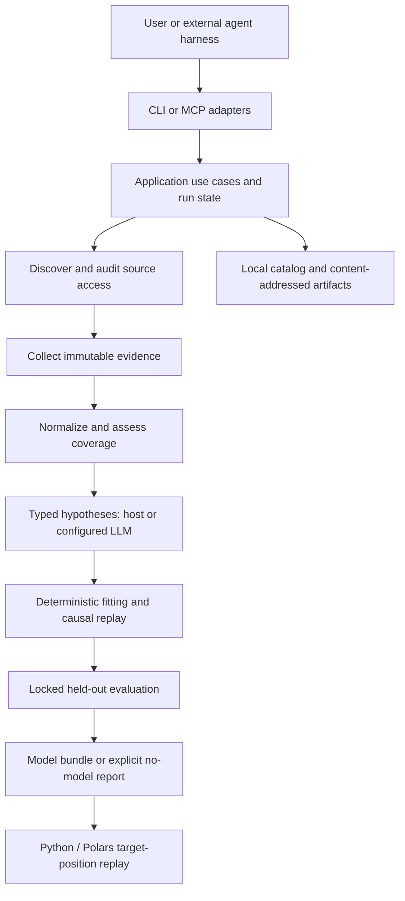

# 01 — Architecture and agent-harness contract

## 1. Architectural decision

Build a local, harness-neutral toolset. External agents can drive individual
operations through CLI or MCP; a bounded built-in orchestrator can drive the
same operations from a ResearchRequest. Do not build a nested general-purpose
coding agent, shell agent, or mandatory multi-agent framework.

The LLM interprets objectives, proposes structured hypotheses, and explains
results. Application code controls authority, stage transitions, budgets,
data access, numeric fitting, evaluation, and artifact publication. LLM text
cannot grant itself permission, change held-out splits, or promote a model.



## 2. Proposed repository structure

```text
pyproject.toml
uv.lock
src/reta/
  domain/             identifiers, typed specs, policies, outcomes
  application/        use cases, run state machine, ports, budgets
  adapters/
    sources/          generic imports, audited HTTP/browser connectors
    storage/          SQLite catalog, local immutable artifacts
    llm/              structured-output provider adapter
    execution/        trusted interpreter worker, optional sandbox runner
  data/               Polars normalization, labels, calendars, alignment
  models/             spec grammar, feature expressions, position kernels
  evaluation/         splits, matching, metrics, promotion rules
  interfaces/
    cli/              commands, JSON rendering, process exit mapping
    mcp/              tool/resource schemas and transport mapping
  settings/           the only environment/secret readers
  cli.py              composition entry point
schemas/              generated JSON Schemas, not hand-maintained duplicates
examples/             licensed/synthetic fixtures and complete request files
skills/reta/          later harness workflow instructions, no hidden runtime
scripts/              reproducible smoke commands when implementation exists
tests/                behavioral unit, integration, and replay tests
plans/                these design documents
```

Dependencies point inward: interfaces -> application -> domain. Adapters
implement application ports. Numerical modules consume explicit contracts
and frames, not database connections or ambient clocks. The composition root
wires adapters. Keep one implementation of each use case; transport adapters
must not contain model logic.

## 3. Core application operations and ports

| Use case | Input -> output | Required invariant |
| --- | --- | --- |
| `create_run` | ResearchRequest -> RunManifest | Validate constraints and reserve request budget |
| `discover_sources` | request + registry/search capability -> SourceCandidate[] | URLs and claims carry provenance, never imply access |
| `audit_source` | candidate + access policy -> AccessProbe | Permission/access/capability verdict required |
| `collect_evidence` | approved probe + collection bounds -> EvidenceRecord[] | Raw artifacts retained before normalization |
| `normalize_dataset` | evidence refs + instrument mappings -> DatasetManifest | Revisions, nulls, units, unknown intervals survive |
| `assess_evidence` | datasets + requested claim -> assessment artifact | Identify executable and comparable claim dimensions |
| `submit_hypotheses` | run + StrategySpec[] -> hypothesis artifact | Grammar, evidence citations, trial limits enforced |
| `fit_candidates` | frozen specs + split manifest -> FitResult[] | Fit cannot read held-out test targets |
| `validate_candidates` | fitted specs + locked policy -> EvaluationReport[] | No promotion for missing/inapplicable required metric |
| `package_result` | run + reports -> model/no-model bundle | Atomic bundle publication with complete lineage |
| `generate_positions` | ModelBundle + bars + ModelContext -> positions artifact | Same executable semantics as validation |

Ports: `SourceRegistry`, `SearchProvider`, `SourceConnector`, `MarketDataProvider`,
`ArtifactStore`, `RunRepository`, `HypothesisProvider`, `ModelExecutor`.
Declare `typing.Protocol` next to the consuming use case. Do not expose one
unbounded `run_python` or `browse_anything` tool. A source connector declares
its supported modalities, source account mode, collection limits, permitted
access methods, and parser version.

## 4. Run lifecycle

Stage order: `intake`, `discover`, `audit_access`, `collect`, `normalize`,
`assess`, `hypothesize`, `fit`, `validate`, `package`.

Separate fields prevent ambiguous states:

- `state`: `pending`, `running`, `needs_user_action`, or `terminal`.
- `current_stage`: one of the stage names, null after terminal publication.
- `outcome`: null until terminal, then `succeeded`, `insufficient_evidence`,
  `no_candidate_passed`, `blocked`, `failed`, or `cancelled`.
- `blocked_reason`: structured code/details/required action, otherwise null.

`succeeded` means at least one candidate passed all required claim gates and
a replayable bundle was published. `insufficient_evidence` means the required
claim cannot be tested. `no_candidate_passed` means it could be tested but
all candidates failed. `blocked` names an unavailable capability or permission
with no current authorized path. `failed` is an operational/invariant failure,
not an honest inference failure. Cancellation preserves completed evidence.

`needs_user_action` is a resumable pause for free login, permission review,
or a missing user-specific instrument mapping. It cannot loop autonomously
through login pages. If unattended mode forbids waiting, publish `blocked`.
Prompt injection in a page is untrusted evidence, not a valid user action.

### Checkpoint and resume rules

Each stage attempt records its input artifact IDs, spec/config/code versions,
start/finish times, resource counters, output IDs, and disposition. Derive an
input fingerprint from canonical JSON plus referenced content hashes. Reuse
only a completed attempt with identical inputs and compatible versions.
Changed inputs create a new attempt and invalidate dependent stages, never
rewrite prior evidence or silently reuse a stale fit. A terminal run is
immutable; altered constraints create a new run referencing its parent.

Use SQLite transactions for catalog/run transitions and a single local
writer lease per run. Publish artifacts by writing a staging file, hashing,
fsync/atomic rename, then committing catalog references. On crash, unreferenced
complete blobs can be adopted by digest; staging files are never results.
A replay command must verify hashes before executing a bundle.

## 5. CLI surface

All examples below are **planned commands**, not commands available today.
Global option: `--workspace PATH` (default `.reta`). `--json` emits one typed
JSON result on stdout; progress/diagnostics go to stderr. Canonical input
files are JSON; shell command strings are not accepted as model code.

```text
reta --workspace .reta research --request examples/request.json --json
reta --workspace .reta research --resume RUN_ID --json
reta --workspace .reta sources discover --request examples/request.json --json
reta --workspace .reta sources audit --run RUN_ID --candidate CANDIDATE_ID --json
reta --workspace .reta evidence collect --run RUN_ID --probe PROBE_ID --json
reta --workspace .reta evidence import --run RUN_ID --manifest import.json --json
reta --workspace .reta dataset build --run RUN_ID --json
reta --workspace .reta hypotheses submit --run RUN_ID --spec hypotheses.json --json
reta --workspace .reta models fit --run RUN_ID --json
reta --workspace .reta models validate --run RUN_ID --json
reta --workspace .reta bundle export --run RUN_ID --output result/ --json
reta --workspace .reta positions generate --bundle result/ --bars bars.parquet --context context.json --output positions.parquet --json
reta --workspace .reta runs inspect --run RUN_ID --json
reta --workspace .reta runs cancel --run RUN_ID --json
reta --workspace .reta mcp serve
```

`research --request` creates a run and executes allowable stages.
`research --resume` resumes that run using its checkpointed request.
In host-driven mode it pauses at `hypothesize` until specs are submitted.
Local artifact sources skip network discovery/collection; stage attempts
record `not_required`, not fake successful web calls.
Standalone discovery persists candidate records in the workspace catalog.
An audit attaches a selected candidate to the requested run only after
checking it against that run's source/origin/budget constraints. Commands
with `--run` resolve and update that run. `positions generate` works offline
from a bundle.

Exit mapping: 0 completed operation (inspect JSON outcome), 2 invalid input,
3 needs action/blocked, 4 insufficient evidence/no candidate, 1 operational
failure, 130 cancellation. Inspecting a failed historical run is still a
successful inspect operation. A failed research result must not look like a
successful model export simply because JSON was printed.

## 6. MCP surface

Use the official [Python SDK](https://github.com/modelcontextprotocol/python-sdk),
pin a compatible version at implementation time, and negotiate protocol
support. Do not copy stale SDK import names from old tutorials. The official
[server guide](https://modelcontextprotocol.io/docs/develop/build-server)
requires stdio stdout to contain protocol messages only; logs belong on stderr.

Tools map one-to-one to application operations:

| Tool | Arguments beyond common run ID where relevant |
| --- | --- |
| `reta_research` | `request` or `resume_run_id` (exactly one) |
| `reta_discover_sources` | `request` |
| `reta_audit_source` | `run_id`, `candidate_id` |
| `reta_collect_evidence` | `run_id`, `probe_id` |
| `reta_import_evidence` | `run_id`, `import_manifest` |
| `reta_build_dataset` | `run_id` |
| `reta_submit_hypotheses` | `run_id`, `specs` |
| `reta_fit_models` | `run_id` |
| `reta_validate_models` | `run_id` |
| `reta_export_bundle` | `run_id`, `destination` |
| `reta_generate_positions` | `bundle_ref`, `bars_ref`, `context`, `destination` |
| `reta_inspect_run` / `reta_cancel_run` | `run_id` |

Long operations return an operation reference promptly, rather than keeping
a host request alive for an entire search. `reta_inspect_run` reads progress
and terminal results; cancellation targets the owned operation. CLI waits
and streams progress unless cancelled. No daemon or distributed queue is
required: the local MCP process owns its worker process and persisted run
state; a restart resumes explicit checkpoints.

Tool replies contain `schema_version`, `operation_id`, `run_id`, `status`,
`result_ref`, bounded `summary`, `limitations`, and optional typed `error`.
`status` is `accepted`, `completed`, `needs_user_action`, or `error`; run
outcomes remain in RunManifest. MCP operational failures use protocol tool
errors; `no_candidate_passed` is domain data, not a transport exception.
Resource URIs `reta://runs/{id}`, `reta://artifacts/{digest}`, and
`reta://models/{digest}` support summaries and bounded row/section reads.
Every paged result repeats coverage and next-page state. Never imply complete
history merely because one response page is exhausted.

## 7. Agent authority and resource controls

A ResearchRequest fixes maximum sources, pages, bytes, wall time, LLM calls,
tokens, fit trials, and candidate count. A shared persisted counter is charged
before dispatch so resume cannot reset the budget. A budget exhaustion records
partial coverage and prevents new work; it never weakens promotion criteria.
Only per-provider transient retries within the existing request cap are
allowed, with bounded attempts and documented backoff/Retry-After handling.
Do not retry permission denials or interpret a login page as an empty ledger.

Search is a configured adapter, not a presumed free API. Without it, URL or
registry discovery and local imports still work. Model/API credentials are
settings or secret-file references; they never enter model prompts, bundles,
SQLite evidence payloads, or MCP responses. Source accounts use opaque local
profile references, not exported cookies.

Restrict fetching to policy-approved public origins; reject private,
loopback, link-local and cloud metadata targets, including redirects/DNS
rebinding. File imports and outputs stay inside explicit allowed roots;
resolve symlinks and reject traversal. Resource reads cannot become arbitrary
filesystem or network reads. Pages, exports, scripts, and descriptions are
untrusted data even when retrieved from reputable platforms.

Default model execution interprets a finite StrategySpec using trusted code.
The Python exporter emits from trusted templates; the LLM never controls an
`eval` string. If arbitrary generated Python is later accepted, require a
separate enforced sandbox: no network, no secrets/host environment, read-only
inputs, scratch-only output, CPU/memory/process/file/time limits. A subprocess
alone is not a sandbox; AST import filters alone are not a sandbox. If the
capability is unavailable, reject that execution mode, not the safe interpreter.
